<h1 align="center">Dependency Parser</h1>

<p align="center">
  <em>An arc-standard, transition-based dependency parser built from scratch: a static oracle, an averaged structured perceptron policy, greedy decoding, and attachment-score evaluation, with zero runtime dependencies.</em>
</p>

<p align="center">
  <a href="https://github.com/adeoluo/dependency-parser/actions/workflows/ci.yml"></a>
  
  
  
  
  
</p>

---

## Motivation

A dependency parse states, for every word in a sentence, which other word it depends on and
how. It is the backbone of relation extraction, question answering, and grammatical analysis.
Transition-based parsing casts this structured prediction problem as a sequence of local
decisions over a stack and a buffer, so a sentence of length *n* is parsed in a linear number
of steps. This project implements the **arc-standard** system (Nivre, 2004) **from scratch**: the configuration and transitions, the **static oracle** that turns a gold tree
into the transition sequence that builds it, an **averaged structured perceptron** policy over
sparse features, and greedy decoding, all with **zero runtime dependencies** and no automatic
differentiation.

## Architecture

<p align="center">
  
</p>

A configuration holds a stack, a buffer, and the arcs committed so far. At each step the
perceptron scores every legal transition from the surrounding words and parts of speech and
the most probable one is applied. See the [ADRs](docs/adr/) for the key decisions.

## The transition system

The arc-standard system uses three transition families:

- **SHIFT** moves the front of the buffer onto the stack.
- **LEFT(label)** attaches the second stack item as a `label` dependent of the top item, then
  removes the second item.
- **RIGHT(label)** attaches the top stack item as a `label` dependent of the second item, then
  removes the top item.

A **static oracle** maps a gold tree to the unique transition sequence that constructs it,
preferring LEFT, then RIGHT, then SHIFT, and only committing a RIGHT attachment once the top
item has collected all of its own dependents. The policy is an **averaged structured
perceptron**: training follows the oracle sequence with teacher forcing, and on every decision
where the highest-scoring legal transition disagrees with the oracle the weights are moved
toward the oracle transition and away from the prediction. Collins-style averaging is applied
lazily with update timestamps.

## Results

> Reproduce with `python -m dependency_parser evaluate`. Scoring excludes the artificial root.
> UAS is the fraction of tokens attached to the correct head; LAS additionally requires the
> correct relation label.

| Metric | Value |
|---|---:|
| **unlabeled attachment score (UAS)** | **0.9879** |
| **labeled attachment score (LAS)** | **0.9879** |
| left-branching baseline UAS | 0.0558 |
| held-out tokens | 663 |

On a held-out treebank the from-scratch parser reaches **0.9879 UAS**. The residual errors are
concentrated on genuinely ambiguous **prepositional attachments**: the treebank deliberately
makes some prepositions lean toward noun attachment and others toward verb attachment while
leaving a residue that cannot be resolved from the observable tokens. The parser learns the
per-preposition bias and accepts the irreducible remainder, exactly as a real parser must.

## Demonstration

```text
$ python -m dependency_parser parse the/DET engineer/NOUN trains/VERB the/DET model/NOUN
Predicted dependencies (dependent -> head : relation):
  the            -> engineer       : det
  engineer       -> trains         : nsubj
  trains         -> ROOT           : root
  the            -> model          : det
  model          -> trains         : dobj
```

The parser recovers the full tree: the determiners attach to their nouns, the subject and
object attach to the verb, and the verb is the sentence root.

## Quickstart

```bash
git clone https://github.com/adeoluo/dependency-parser.git && cd dependency-parser
make setup                    # install dev tooling + pre-commit hooks
make all                      # lint + type-check + test

python -m dependency_parser evaluate                                   # attachment scores
python -m dependency_parser parse the/DET engineer/NOUN trains/VERB    # parse a sentence
```

Train on your own grammar or treebank:

```python
from dependency_parser import Parser, TrainingConfig
from dependency_parser.data import train_data

parser = Parser.train(train_data(), TrainingConfig(epochs=10))
parse = parser.parse(train_data()[0])
print(parse.heads, parse.labels)
```

## Running the service

A dependency-free HTTP service trains the parser once at startup and parses sentences:

```bash
python -m dependency_parser serve --port 8000

curl localhost:8000/health
curl -s -X POST localhost:8000/parse \
  -d '{"tokens": [{"form": "the", "pos": "DET"}, {"form": "model", "pos": "NOUN"}, {"form": "runs", "pos": "VERB"}]}'
curl localhost:8000/evaluate
```

See the [operations guide](docs/OPERATIONS.md) for the service contract and constraints. The
service also exposes `GET /ready` (readiness) and `GET /metrics` (per-route request, error,
and latency metrics in Prometheus text format). A production-style stress benchmark
(`uv run python benchmarks/stress.py`) reports throughput and p50/p95/p99 latency; the scaling
path and tradeoffs are in [docs/SCALING.md](docs/SCALING.md) and a full walk-through is in the
[case study](docs/CASE_STUDY.md).

## Components

- **data** - a projective treebank generated from a small dependency grammar, with disjoint
  splits and deliberate prepositional-attachment ambiguity.
- **transitions** - the arc-standard configuration, transitions, and the static oracle.
- **features** - sparse feature templates over the stack and buffer context.
- **perceptron** - the averaged structured perceptron with lazy weight averaging.
- **parser** - the training loop and greedy decoder.
- **evaluation** - unlabeled and labeled attachment scoring.

## Design decisions

- **Arc-standard transitions with a static oracle.** Linear-time parsing with an exact oracle
  for every projective tree, which keeps training simple and fully supervised.
  ([ADR-0002](docs/adr/0002-arc-standard-oracle.md))
- **An averaged structured perceptron, not a neural policy.** A sparse linear model with
  Collins averaging is transparent, dependency-free, and strong on this task.
  ([ADR-0003](docs/adr/0003-averaged-perceptron.md))

## Responsible AI

- **Model card:** [docs/MODEL_CARD.md](docs/MODEL_CARD.md)
- **Data card:** [docs/DATA_CARD.md](docs/DATA_CARD.md)
- **Threat model:** [docs/THREAT_MODEL.md](docs/THREAT_MODEL.md)

## Limitations

- The parser is greedy; a beam search or a globally normalized objective would recover some
  of the errors that greedy decoding commits.
- Arc-standard handles projective trees only; non-projective structures need a different
  system such as arc-eager with swap or a graph-based parser.
- The treebank is generated from a grammar rather than annotated by hand, so the vocabulary
  and the construction inventory are illustrative.

## Roadmap

- [ ] Beam search with early update
- [ ] An arc-eager system with the swap transition for non-projective trees
- [ ] Richer features (morphology, distance buckets, label history)

## License

[MIT](LICENSE). Part of an artificial intelligence engineering portfolio by
[adeoluo](https://github.com/adeoluo).
